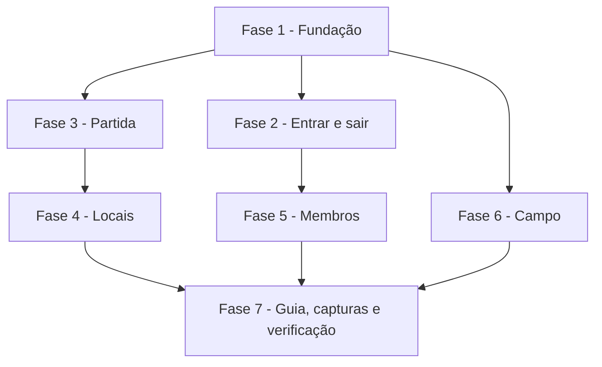

# Tarefas AlfaFut - Fluxo da turma pelo site

Escopo: telas e regras que faltam para usar o AlfaFut só pelo navegador: entrar e sair da turma, partida, local, membros, cadastro de campo, guia e capturas fictícias. Itens 13, 23, 31 e 33 da auditoria de 05/11/2026, mais a tarefa 7.5 de `seguranca-base`.

**Legenda de status:**
- `[ ]` Pendente
- `[~]` Em andamento
- `[x]` Concluido
- `[!]` Bloqueado

**Legenda de criticidade:**
- `[C]` Critico - Impacto financeiro direto ou bloqueante
- `[A]` Alto - Funcionalidade essencial
- `[M]` Medio - Necessario mas sem urgencia imediata

---

## FASE 1 - Fundação

### 1.1 Fuso e idioma `[A]`

Ref: spec.md FR-012, FR-028; research.md Decision 1

- [x] 1.1.1 Trocar o padrão de `config/app.php` e `.env.example` para `America/Sao_Paulo` e `pt_BR`
- [x] 1.1.2 Criar `lang/pt_BR/validation.php` com as mensagens e os nomes de campo usados
- [x] 1.1.3 Testar partida para daqui a 1 hora e mensagem de validação em português

### 1.2 Exceção de regra e aviso de erro `[A]`

Ref: spec.md FR-006, FR-028; research.md Decision 2

- [x] 1.2.1 Criar `app/Exceptions/RegraDaTurma.php`, com `{mensagem}` na API e aviso no site
- [x] 1.2.2 Mostrar `session('erro')` em `layouts/app.blade.php` com `role="alert"`
- [x] 1.2.3 Cobrir as duas respostas pelos testes das fases seguintes

---

## FASE 2 - Entrar e sair da turma

### 2.1 Serviço de vínculo `[C]`

Ref: spec.md FR-001 a FR-006; data-model.md

- [x] 2.1.1 Escrever `tests/Feature/FluxoTurma/EntrarSairTest.php` vendo os testes falharem
- [x] 2.1.2 Criar `app/Services/MembrosDaTurma.php` com entrar e sair
- [x] 2.1.3 Usar o serviço em `Api/PatotaController`, sem mudar o formato da resposta

### 2.2 Telas de entrar e sair `[A]`

Ref: spec.md FR-001, FR-002, FR-005

- [x] 2.2.1 Criar rotas `patotas.entrar`, com o limite `entrar-codigo`, e `patotas.sair`
- [x] 2.2.2 Criar `partials/entrar-codigo.blade.php` e incluir no painel e em Turmas
- [x] 2.2.3 Colocar "Sair da turma" em `patotas/show`, escondido do criador

---

## FASE 3 - Partida

### 3.1 Validação única de partida `[C]`

Ref: spec.md FR-008, FR-009, FR-014, FR-015, FR-029; research.md Decision 3

- [x] 3.1.1 Escrever `tests/Feature/FluxoTurma/PartidaTest.php` vendo os testes falharem
- [x] 3.1.2 Criar `app/Http/Requests/SalvarPartidaRequest.php`
- [x] 3.1.3 Em `Partida`: `campo_id` preenchível, relação `campo`, `lugar()`, `podeSerAlterada()`, `situacao()` e cancelada em "Passadas"
- [x] 3.1.4 Usar a validação em `Api/PartidaController`, recusar alteração fora de estado e expor `campo` em `PartidaResource`

### 3.2 Telas de partida `[A]`

Ref: spec.md FR-007, FR-009, FR-010, FR-011

- [x] 3.2.1 Criar `create`, `store`, `edit`, `update` e `cancelar` em `Web/PartidaController`, trocando os stubs
- [x] 3.2.2 Criar `partidas/create`, `edit` e `_form`
- [x] 3.2.3 Colocar "Nova partida" na turma e "Alterar" e "Cancelar" na partida, só para quem organiza
- [x] 3.2.4 Mostrar local ou campo, e a situação, em `partidas/show`, `partidas/index` e no painel

---

## FASE 4 - Locais

### 4.1 Locais da turma `[A]`

Ref: spec.md FR-013, FR-014, FR-016, FR-017; research.md Decision 6

- [x] 4.1.1 Escrever `tests/Feature/FluxoTurma/LocalTest.php` vendo os testes falharem
- [x] 4.1.2 Criar `Web/LocalController` e as rotas
- [x] 4.1.3 Criar `locais/index`, `create`, `edit` e `_form`, e o caminho a partir da partida e da turma

---

## FASE 5 - Membros

### 5.1 Gestão de membros `[C]`

Ref: spec.md FR-018 a FR-023; data-model.md; research.md Decisions 4 e 5

- [x] 5.1.1 Escrever `tests/Feature/FluxoTurma/MembrosTest.php` vendo os testes falharem
- [x] 5.1.2 Ampliar `MembrosDaTurma` com papel, remover, liberar e transferir; criar `gerenciarMembros` em `PatotaPolicy`
- [x] 5.1.3 Criar `Web/MembroController`, as rotas e `patotas/membros.blade.php`
- [x] 5.1.4 Limitar `responsavel_id` a membro ativo em `Web/PatotaController@update`
- [x] 5.1.5 Mostrar o código de convite a quem organiza e os atalhos em `patotas/show`

---

## FASE 6 - Campo

### 6.1 Regras do cadastro de campo `[A]`

Ref: spec.md FR-017, FR-024, FR-025

- [x] 6.1.1 Escrever `tests/Feature/FluxoTurma/CampoTest.php` vendo os testes falharem
- [x] 6.1.2 Criar `CampoPolicy` e usar em todas as ações de `Web/CampoController`
- [x] 6.1.3 Normalizar as caixas ao salvar e fazer o campo novo nascer ativo

---

## FASE 7 - Guia, capturas e verificação

### 7.1 Guia verdadeiro `[A]`

Ref: spec.md FR-026

- [x] 7.1.1 Reescrever os passos 4, 5 e 11 de `como-usar.blade.php` conforme as telas reais
- [x] 7.1.2 Conferir os demais passos contra as telas e corrigir o que não existir

### 7.2 Capturas fictícias `[C]`

Ref: spec.md FR-027; `seguranca-base` tarefa 7.5

- [x] 7.2.1 Refazer as capturas usadas pelas páginas com o seed fictício
- [x] 7.2.2 Apagar as capturas sem uso e conferir cada imagem
- [x] 7.2.3 Marcar a tarefa 7.5 de `seguranca-base`

### 7.3 Prova final `[A]`

Ref: spec.md SC-001 a SC-006, FR-028; quickstart.md

- [x] 7.3.1 Acrescentar as ações novas a `MatrizPermissoesTest`
- [x] 7.3.2 Rodar a suíte completa, o Pint nos arquivos alterados e `npm run build`
- [x] 7.3.3 Percorrer os cenários em navegador, em 1280 e 390 px, atrás do nginx com MySQL

---

## Matriz de Dependencias

## Resumo Quantitativo

| Fase | Tarefas | Subtarefas | Criticidade Predominante |
|------|---------|------------|--------------------------|
| FASE 1 - Fundação | 2 | 6 | Alto |
| FASE 2 - Entrar e sair da turma | 2 | 6 | Critico |
| FASE 3 - Partida | 2 | 8 | Critico |
| FASE 4 - Locais | 1 | 3 | Alto |
| FASE 5 - Membros | 1 | 5 | Critico |
| FASE 6 - Campo | 1 | 3 | Alto |
| FASE 7 - Guia, capturas e verificação | 3 | 8 | Alto |
| **Total** | **12** | **39** | |

## Escopo Coberto

| Item | Descricao | Fase |
|------|-----------|------|
| Item 13 da auditoria | Telas de partida, entrar, sair e local | 2, 3, 4 |
| Item 23 da auditoria | Gestão de membros e responsável só entre membros | 5 |
| Item 31 da auditoria | Campo restrito e caixas que desmarcam | 6 |
| Item 33 da auditoria | Fuso de Brasília, antecipado porque o formulário depende dele | 1 |
| `seguranca-base` 7.5 | Capturas sem pessoa real | 7 |

## Escopo Excluido

| Item | Descricao | Motivo |
|------|-----------|--------|
| Lista de espera e vaga | Promoção, liberação de vaga, pendências de quem sai | Etapa 4 |
| Português das demais telas | Telas não alteradas nesta frente | Etapa 5 |
| Landing e fotos reais | Tarefa 7.4 de `seguranca-base` | Etapas 6 e 7 |
| CRUD de local pela API e app Flutter | Fora do pedido desta etapa | Sem definição do Felipe sobre o app |
