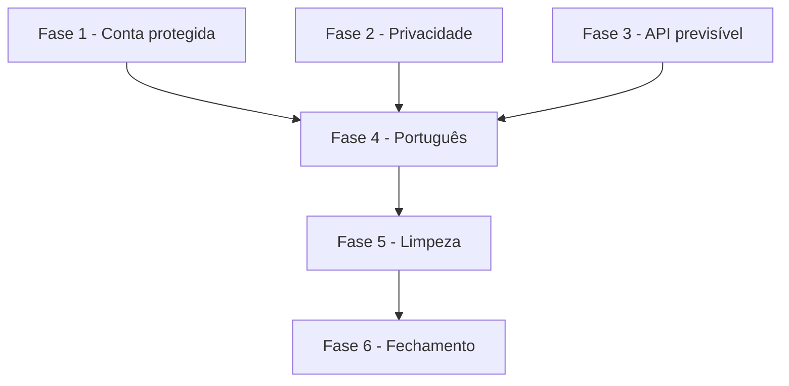

# Tarefas AlfaFut - Português, LGPD e limpeza

Escopo: recuperação de senha com resposta única, validade e encerramento de acessos, política e termos com aceite, download dos próprios dados, API sempre em JSON, texto em português, remoção de restos do trabalho de faculdade e capturas refeitas.

**Legenda de status:**
- `[ ]` Pendente
- `[~]` Em andamento
- `[x]` Concluido
- `[!]` Bloqueado

**Legenda de criticidade:**
- `[C]` Critico - Impacto financeiro direto ou bloqueante
- `[A]` Alto - Funcionalidade essencial
- `[M]` Medio - Necessario mas sem urgencia imediata

---

## FASE 1 - Conta protegida

### 1.1 Recuperação de senha com resposta única `[C]`

Ref: spec.md FR-001; research.md Decision 1

- [x] 1.1.1 Escrever os testes de resposta igual no site e na API, com e sem conta
- [x] 1.1.2 Criar `RecuperacaoDeSenha` com o envio depois da resposta
- [x] 1.1.3 Usar o serviço nos dois controllers
- [x] 1.1.4 Unificar a mensagem de erro da tela de nova senha

### 1.2 Validade e encerramento de acessos `[C]`

Ref: spec.md FR-002 a FR-005; research.md Decision 2, 3

- [x] 1.2.1 Escrever os testes de acesso vencido e de troca de senha
- [x] 1.2.2 Definir a validade de 60 dias
- [x] 1.2.3 Criar `EncerramentoDeAcessos`
- [x] 1.2.4 Chamar o serviço na troca pelo perfil e na redefinição pelo link
- [x] 1.2.5 Limpar os acessos vencidos ao subir a imagem

---

## FASE 2 - Privacidade

### 2.1 Responsável e checagem de produção `[C]`

Ref: spec.md FR-008, FR-009; research.md Decision 4

- [x] 2.1.1 Criar `config/alfafut.php` e as variáveis no `.env.example`
- [x] 2.1.2 Fazer `alfafut:checar-producao` recusar sem nome e contato
- [x] 2.1.3 Ajustar o compose de homologação com valores fictícios
- [x] 2.1.4 Testar a recusa

### 2.2 Política e termos `[C]`

Ref: spec.md FR-006, FR-007, FR-011

- [x] 2.2.1 Conferir no código os dados guardados e quem os vê
- [x] 2.2.2 Escrever a política de privacidade
- [x] 2.2.3 Escrever os termos de uso
- [x] 2.2.4 Criar as rotas públicas e o rodapé com os links
- [x] 2.2.5 Testar as páginas sem login

### 2.3 Aceite no cadastro `[C]`

Ref: spec.md FR-010; data-model.md; research.md Decision 5

- [x] 2.3.1 Criar a migração de `termos_aceitos_em` e `termos_versao`
- [x] 2.3.2 Exigir o aceite no site e na API
- [x] 2.3.3 Adicionar a caixa de aceite ao cadastro
- [x] 2.3.4 Testar recusa e gravação

### 2.4 Download dos próprios dados `[C]`

Ref: spec.md FR-012, FR-013; research.md Decision 6; contracts/rotas.md

- [x] 2.4.1 Criar `DadosDoTitular` com lista explícita de campos
- [x] 2.4.2 Criar as rotas no site e na API, com limite
- [x] 2.4.3 Adicionar o botão ao perfil
- [x] 2.4.4 Testar conteúdo, e ausência de senha, token e dados de outras pessoas

---

## FASE 3 - API previsível

### 3.1 Respostas em JSON `[A]`

Ref: spec.md FR-018, FR-019; research.md Decision 7

- [x] 3.1.1 Escrever os testes dos 5 tipos de recusa, com e sem cabeçalho
- [x] 3.1.2 Renderizar tudo em `api/*` como JSON, sem redirecionar
- [x] 3.1.3 Traduzir 401, 404, 405 e 500, sem nome de classe

### 3.2 Campos da API `[A]`

Ref: spec.md FR-020 a FR-023, FR-027; research.md Decision 8

- [x] 3.2.1 Fazer `total_membros` voltar a sair
- [x] 3.2.2 Devolver `tipo_usuario` no perfil próprio
- [x] 3.2.3 Aceitar `tipo_usuario` público no cadastro
- [x] 3.2.4 Tirar `role` e `tipo_usuario` do `$fillable`
- [x] 3.2.5 Testar tudo, inclusive a tentativa de definir `role`

---

## FASE 4 - Português

### 4.1 Telas `[A]`

Ref: spec.md FR-014, FR-016, FR-017; research.md Decision 9

- [x] 4.1.1 Criar a varredura com a lista de palavras, fora do repositório
- [x] 4.1.2 Corrigir o texto das telas
- [x] 4.1.3 Corrigir manifesto, service worker e tela sem conexão
- [x] 4.1.4 Criar as páginas de erro em português
- [x] 4.1.5 Corrigir o texto do seed fictício

### 4.2 Mensagens do servidor `[A]`

Ref: spec.md FR-015, FR-017

- [x] 4.2.1 Corrigir as mensagens dos controllers e dos serviços
- [x] 4.2.2 Conferir as mensagens padrão de validação, autenticação e recuperação
- [x] 4.2.3 Testar que nomes de campo da API não mudaram

---

## FASE 5 - Limpeza

### 5.1 Restos do trabalho de faculdade `[M]`

Ref: spec.md FR-024, FR-028

- [x] 5.1.1 Tirar a citação à faculdade das telas
- [x] 5.1.2 Remover `PartidaDemo`, as partials sem uso e os componentes sem uso
- [x] 5.1.3 Testar que nenhuma tela cita a faculdade

### 5.2 Correções de tela `[M]`

Ref: spec.md FR-025, FR-026; research.md Decision 10

- [x] 5.2.1 Separar o formulário de reenvio do formulário do perfil
- [x] 5.2.2 Consertar o banner de instalar
- [x] 5.2.3 Testar os dois em navegador

### 5.3 Documentação `[M]`

Ref: spec.md FR-024, FR-029, SC-005

- [x] 5.3.1 Reescrever o `README.md`
- [x] 5.3.2 Atualizar `docs/09-api.md` rota a rota, com o envelope de cada resposta
- [x] 5.3.3 Conferir o documento contra as rotas reais com um roteiro

---

## FASE 6 - Fechamento

### 6.1 Capturas `[M]`

Ref: spec.md FR-030

- [ ] 6.1.1 Refazer as capturas com o seed fictício
- [ ] 6.1.2 Conferir uma a uma

### 6.2 Verificação `[A]`

Ref: quickstart.md; constitution VI

- [x] 6.2.1 Rodar PHPUnit e Pint
- [x] 6.2.2 Atualizar os roteiros de navegador com o aceite dos termos
- [x] 6.2.3 Gerar a imagem e rodar os roteiros com MySQL atrás do nginx
- [x] 6.2.4 Varrer as telas abertas em navegador

---

## Matriz de Dependencias

---

## Resumo Quantitativo

| Fase | Tarefas | Subtarefas |
|------|---------|------------|
| FASE 1 - Conta protegida | 2 | 9 |
| FASE 2 - Privacidade | 4 | 18 |
| FASE 3 - API previsível | 2 | 8 |
| FASE 4 - Português | 2 | 8 |
| FASE 5 - Limpeza | 3 | 9 |
| FASE 6 - Fechamento | 2 | 6 |
| **Total** | **15** | **58** |

---

## Escopo Coberto

- Itens 32 e 36 a 40 da auditoria, menos as fotos reais do item 37.
- Formulário de reenvio do perfil, citado na Etapa 4.
- Capturas pendentes das Etapas 3 e 4.

## Escopo Excluido

- Landing nova e fotos reais de pessoas (tarefa 7.4 de `seguranca-base`), porque ficam nas Etapas 6 e 7.
- Aplicativo Flutter, ainda sem decisão do Felipe.
- Novo aceite quando os termos mudarem, porque só faz sentido depois da primeira publicação.
- `/cstk:analyze` e `/cstk:converge`, que ficam para a revisão da Etapa 8.
