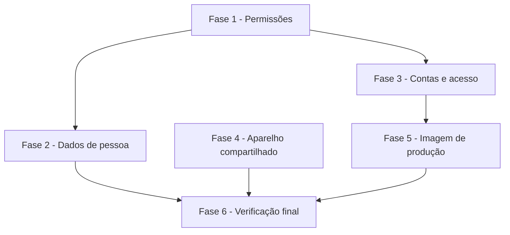

# Tarefas AlfaFut - Base segura para o teste com pessoas reais

Escopo: permissões num ponto único, dados de pessoa protegidos, limite de tentativas, confirmação de e-mail, seed sem credencial, service worker sem página autenticada e imagem de produção. Itens 1-7, 14-16, 30, 34 e 35 da auditoria de 05/11/2026.

**Legenda de status:**
- `[ ]` Pendente
- `[~]` Em andamento
- `[x]` Concluido
- `[!]` Bloqueado

**Legenda de criticidade:**
- `[C]` Critico - Impacto financeiro direto ou bloqueante
- `[A]` Alto - Funcionalidade essencial
- `[M]` Medio - Necessario mas sem urgencia imediata

---

## FASE 1 - Permissões num ponto único

### 1.1 Policies e testes de negação `[C]`

Ref: spec.md FR-005, FR-006, FR-007, FR-008; data-model.md (matriz de permissões)

- [x] 1.1.1 Escrever `tests/Feature/Permissoes/` com a matriz inteira, pelo site e pela API, vendo os testes falharem antes da correção
- [x] 1.1.2 Criar `temMembroAtivo` e `temOrganizador` em `app/Models/Patota.php`
- [x] 1.1.3 Criar `PatotaPolicy`, `PartidaPolicy`, `DespesaPolicy`, `PagamentoPolicy` e `MensagemPolicy`, com `before()` para o admin global
- [x] 1.1.4 Incluir `AuthorizesRequests` em `app/Http/Controllers/Controller.php`

### 1.2 API usando as Policies `[C]`

Ref: spec.md FR-001, FR-002, FR-003, FR-004

- [x] 1.2.1 Autorizar todas as ações de `Api/DespesaController` e recusar `partida_id` de outra turma
- [x] 1.2.2 Autorizar `dados` de `Api/PlacarController` e trocar `authorizeResponsavel` pela Policy
- [x] 1.2.3 Trocar os `authorize*` de `Api/PatotaController`, `PartidaController`, `ConfirmacaoController`, `MensagemController` e `SorteioController`

### 1.3 Site usando as Policies `[C]`

Ref: spec.md FR-004, FR-005, FR-007

- [x] 1.3.1 Autorizar `tv`, `resultado` e `dados` de `Web/PlacarController` e trocar `authorizeResponsavel` pela Policy
- [x] 1.3.2 Trocar os `authorize*` de `Web/PatotaController`, `PartidaController`, `DespesaController`, `MensagemController` e `SorteioController`
- [x] 1.3.3 Rodar a suíte completa e `sondar.py` sem nenhum acesso indevido

---

## FASE 2 - Dados de pessoa

### 2.1 Quem vê o quê de um usuário `[C]`

Ref: spec.md FR-009, FR-010, FR-011; contracts/api.md

- [x] 2.1.1 Escrever os testes de visibilidade para membro, organizador, a própria pessoa e organizador de outra turma
- [x] 2.1.2 Reduzir `UsuarioResource` aos campos públicos
- [x] 2.1.3 Criar `MeuUsuarioResource` e usar em `Api/AuthController` e `Api/UsuarioController`
- [x] 2.1.4 Criar `MembroResource` e usar em `Api/PatotaController::membros`
- [x] 2.1.5 Conferir os `json_encode` de `placar/tv.blade.php` e `placar/controle.blade.php`, para não vazarem campos protegidos

---

## FASE 3 - Contas e acesso

### 3.1 Limite de tentativas e proxy `[A]`

Ref: spec.md FR-018 a FR-023

- [x] 3.1.1 Escrever os testes de limite, com a recusa em português e a outra pessoa da mesma rede passando
- [x] 3.1.2 Criar os limitadores nomeados em `AppServiceProvider`, com a resposta em português
- [x] 3.1.3 Aplicar `throttle:` em `routes/api.php` e `routes/auth.php`
- [x] 3.1.4 Configurar `TrustProxies` por `config('app.proxies_confiaveis')`, com teste contra `X-Forwarded-For` forjado

### 3.2 Confirmação de e-mail `[A]`

Ref: spec.md FR-024 a FR-027

- [x] 3.2.1 Escrever os testes do fluxo pelo site e pela API, incluindo conta já confirmada
- [x] 3.2.2 Ativar `MustVerifyEmail` em `User` e aplicar `verified` nas rotas de API
- [x] 3.2.3 Criar `POST auth/reenviar-confirmacao` e disparar o evento `Registered` no cadastro da API
- [x] 3.2.4 Escrever os e-mails e a tela `auth/verify-email` em português, com rótulos e `aria-live`

### 3.3 Sem credencial de demonstração `[C]`

Ref: spec.md FR-012 a FR-017

- [x] 3.3.1 Escrever os testes de seed recusado em produção, `alfafut:criar-admin` e `alfafut:checar-producao`
- [x] 3.3.2 Reescrever `DatabaseSeeder` e `PatotaSeeder` com dados fictícios, senha gerada no ato e guarda de ambiente
- [x] 3.3.3 Remover `/_demo-login` de `routes/web.php` e ajustar a varredura local <!-- varredura.mjs, fora do repositório -->
- [x] 3.3.4 Criar `alfafut:criar-admin` e `alfafut:checar-producao`
- [x] 3.3.5 Limpar senha e dado pessoal de `README.md`, `scripts/` e `docs/`, conferindo com busca no repositório

---

## FASE 4 - Aparelho compartilhado

### 4.1 Service worker sem dado de turma `[A]`

Ref: spec.md FR-028, FR-029; quickstart.md Scenario 5

- [x] 4.1.1 Reescrever `public/sw.js` como `alfafut-v2`, guardando só arquivos estáticos e páginas públicas
- [x] 4.1.2 Marcar as páginas autenticadas com `no-store`, para não voltarem pelo botão voltar nem pelo cache do navegador depois de sair
- [x] 4.1.3 Testar em navegador real: sair, ficar sem rede e reabrir, e migrar de uma instalação `v1`

---

## FASE 5 - Imagem de produção

### 5.1 Imagem `[A]`

Ref: spec.md FR-030 a FR-034; research.md Decision 5

- [x] 5.1.1 Criar `.dockerignore`
- [x] 5.1.2 Reescrever `Dockerfile` com `php:8.3-fpm-alpine`, nginx, supervisor, `pdo_mysql` e `opcache`
- [x] 5.1.3 Criar `docker/` com a configuração de nginx, supervisor, PHP e o script de entrada
- [x] 5.1.4 Testar o boot recusado com `APP_DEBUG=true`, sem `APP_KEY` e com `MAIL_MAILER=log`

### 5.2 Compose `[A]`

Ref: spec.md FR-035; quickstart.md Scenario 7

- [x] 5.2.1 Prender banco e Adminer em `127.0.0.1` e tirar a senha padrão de `docker-compose.yml`
- [x] 5.2.2 Criar `docker-compose.homolog.yml` com sub-rede `10.253.105.0/24` e caixa de e-mail de desenvolvimento
- [x] 5.2.3 Testar a recriação do contêiner com a conta preservada, e inspecionar o conteúdo da imagem

---

## FASE 6 - Verificação final

### 6.1 Conferência da frente `[A]`

Ref: spec.md SC-001 a SC-009; quickstart.md

- [x] 6.1.1 Rodar o Scenario 8 do quickstart (roundtrip atrás do nginx da imagem)
- [x] 6.1.2 Rodar `/cstk:analyze` e `/cstk:converge` sobre a frente
- [x] 6.1.3 Atualizar `docs/09-api.md` com o que mudou

---

## Matriz de Dependencias

## Resumo Quantitativo

| Fase | Tarefas | Subtarefas | Criticidade |
|------|---------|------------|-------------|
| 1 - Permissões num ponto único | 3 | 10 | C |
| 2 - Dados de pessoa | 1 | 5 | C |
| 3 - Contas e acesso | 3 | 13 | C, A |
| 4 - Aparelho compartilhado | 1 | 3 | A |
| 5 - Imagem de produção | 2 | 7 | A |
| 6 - Verificação final | 1 | 3 | A |
| **Total** | **11** | **41** | - |

## Escopo Coberto

| Item | Descricao | Fase |
|------|-----------|------|
| 2, 5, 30 | API de despesas, leitura de placar, Policies | 1 |
| 6 | Dados de pessoa | 2 |
| 3, 34 (proxy) | Limite de tentativas, `trustProxies` | 3 |
| 4, 16 | Confirmação de e-mail, recuperação entregue | 3, 5 |
| 1, 35 | Seed, `/_demo-login`, compose | 3, 5 |
| 7 | Service worker | 4 |
| 14, 15, 34 (dockerignore) | Imagem de produção | 5 |

## Escopo Excluido

| Item | Descricao | Motivo |
|------|-----------|--------|
| 13, 23, 31 | Telas de partida, entrar e sair da turma, membros, campos | Etapa 3 |
| 8-12, 17-22, 24-29, 33 | Vaga, dinheiro, placar, excluir conta | Etapa 4 |
| 32, 36-40 | Enumeração de e-mail, tradução geral, LGPD, limpeza | Etapa 5 |
| Backup | Agendamento e restauração | Etapa 9, com o servidor definido |
| Histórico do git | Remover a senha do histórico | Depende da decisão do Felipe |
| App Flutter | Ajuste ao novo contrato da API | Depende da decisão do Felipe |

## FASE 7 - Convergência

> Fase gerada pela skill `converge` (reconciliação spec-vs-código). Cada tarefa abaixo corresponde a um achado
> entre o que os artefatos descreveram e o estado presente do código. Append-only: esta fase não reescreve as anteriores.

### 7.1 Persona com dado de pessoa real `[C]`

Ref: 3.3 · tipo: `contradicts` · severidade: `CRITICAL`

A tarefa 3.3.5 limpou dado pessoal de `docs/`, mas `docs/01-personas.md` descreve uma pessoa real com nome completo, idade, ocupação e empresa, em repositório público (FR-013; constitution IV). `docs/06-prototipo-baixa-fidelidade.md` e `docs/08-arquitetura.md` repetem o primeiro nome nos exemplos.

- [x] 7.1.1 Trocar por persona fictícia em `docs/01-personas.md`, `docs/06-prototipo-baixa-fidelidade.md` e `docs/08-arquitetura.md`

<!-- converge-key: 59196a7a7a04 -->

### 7.2 Exemplo da API com nome real `[C]`

Ref: 3.3 · tipo: `contradicts` · severidade: `CRITICAL`

O corpo de exemplo de `POST /auth/registrar` em `docs/09-api.md` usa o nome completo de uma pessoa real (FR-013; constitution IV).

- [x] 7.2.1 Trocar o exemplo de `docs/09-api.md` por dados fictícios

<!-- converge-key: a6aa11bbd421 -->

### 7.3 Roteiro de sondagem fora do repositório `[C]`

Ref: 1.3 · tipo: `missing` · severidade: `HIGH`

A tarefa 1.3.3 cita `sondar.py`, que não existe no repositório: fica em `~/projetos/.demos/alfafut` porque descreve falhas e o repositório é público. A prova versionada das mesmas recusas está em `tests/Feature/Permissoes/`.

- [x] 7.3.1 Registrar que `sondar.py` segue fora do repositório enquanto ele for público <!-- sondar.py em ~/projetos/.demos/alfafut; versionar só se o repositório ficar privado -->

<!-- converge-key: 099116d9b3d3 -->

### 7.4 Fotos de pessoas reais na página pública `[C]`

Ref: constitution IV · tipo: `contradicts` · severidade: `CRITICAL`

`resources/views/welcome.blade.php:107` e `:193` exibem `public/images/eventos/*.jpg`, e as fotos entram na imagem de produção. A constitution exige termo de cessão arquivado; a landing nova decidiu ficar sem elas até lá. Bloqueia a publicação.

- [ ] 7.4.1 Tirar `public/images/eventos/` da página pública e da imagem na landing nova (Etapas 6 e 7), ou arquivar os termos de cessão

<!-- converge-key: fcaa4b7832cb -->

### 7.5 Capturas de tela com nome de pessoa real `[C]`

Ref: constitution IV · tipo: `contradicts` · severidade: `CRITICAL`

As capturas em `public/images/screenshots/`, usadas em `welcome.blade.php` e `como-usar.blade.php`, mostram o nome de uma pessoa real (por exemplo, "Patota do Felipe" em `06-patota-detalhe.png`). A constitution proíbe dado real em captura de tela. Bloqueia a publicação.

- [x] 7.5.1 Refazer as capturas com o seed fictício, junto com as telas da Etapa 3 e a landing nova <!-- feito em docs/specs/fluxo-web-turma, tarefa 7.2 -->

<!-- converge-key: f2c88962bc5c -->

