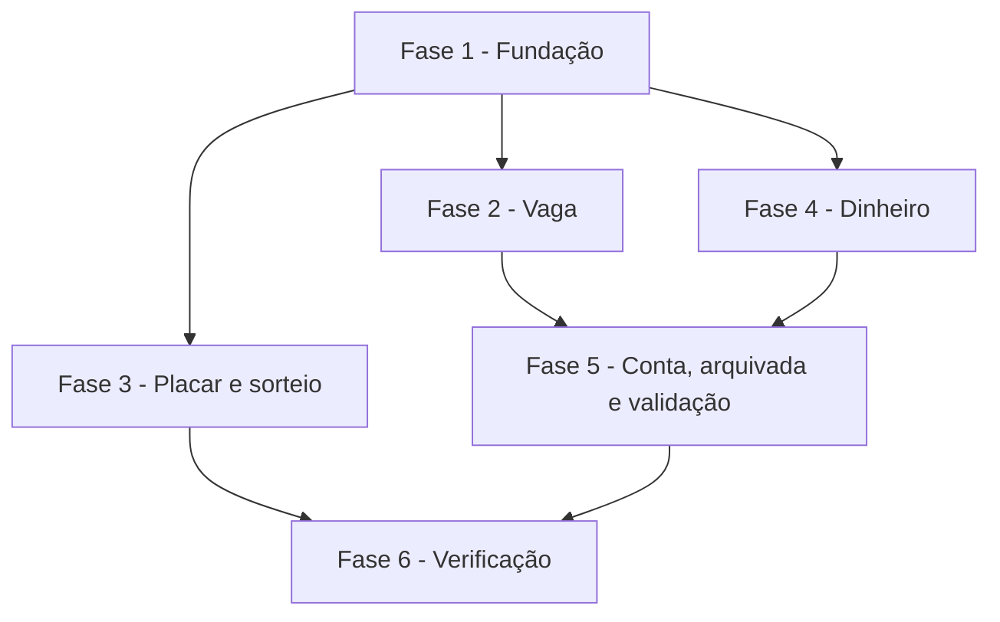

# Tarefas AlfaFut - Vaga, dinheiro e placar

Escopo: regras de vaga, placar, sorteio e dinheiro em serviços únicos, exclusão de conta sem prejudicar a turma, turma arquivada e validação de valores e IDs.

**Legenda de status:**
- `[ ]` Pendente
- `[~]` Em andamento
- `[x]` Concluido
- `[!]` Bloqueado

**Legenda de criticidade:**
- `[C]` Critico - Impacto financeiro direto ou bloqueante
- `[A]` Alto - Funcionalidade essencial
- `[M]` Medio - Necessario mas sem urgencia imediata

---

## FASE 1 - Fundação

### 1.1 Migrações e modelos `[A]`

Ref: data-model.md; research.md Decision 6, 7

- [x] 1.1.1 Criar a migração de `movimentos_financeiros` e o modelo `MovimentoFinanceiro`
- [x] 1.1.2 Criar a migração de `users.excluida_em`
- [x] 1.1.3 Conferir as duas migrações em SQLite e em MySQL

### 1.2 Dinheiro em centavos `[C]`

Ref: spec.md FR-021, FR-022; research.md Decision 4

- [x] 1.2.1 Criar `App\Support\Dinheiro` com conversão, divisão e formatação
- [x] 1.2.2 Testar conversão sem ponto flutuante
- [x] 1.2.3 Testar divisão que fecha ao centavo

---

## FASE 2 - Vaga

### 2.1 Serviço de vagas `[C]`

Ref: spec.md FR-001 a FR-006, FR-008, FR-009; research.md Decision 1

- [x] 2.1.1 Criar `VagasDaPartida` com confirmar, recusar, cancelar e reorganizar, em transação com trava da partida
- [x] 2.1.2 Usar o serviço nos controllers do site e da API
- [x] 2.1.3 Promover da fila ao aumentar as vagas
- [x] 2.1.4 Mostrar na tela da partida o motivo de não poder confirmar
- [x] 2.1.5 Testar repetição, prazo, cancelada, lista desligada, fila andando e renumeração no site e na API

### 2.2 Saída da turma libera a vaga `[A]`

Ref: spec.md FR-007

- [x] 2.2.1 Liberar vagas futuras em `MembrosDaTurma` ao sair e ao remover
- [x] 2.2.2 Avisar quem sai sobre o valor pendente
- [x] 2.2.3 Testar saída, remoção e partida iniciada intacta

---

## FASE 3 - Placar e sorteio

### 3.1 Serviço de placar `[A]`

Ref: spec.md FR-010 a FR-014, FR-016; research.md Decision 2

- [x] 3.1.1 Criar `PlacarDaPartida` com iniciar, pausar, finalizar, registrar e remover gol, e recálculo a partir dos eventos
- [x] 3.1.2 Usar o serviço nos controllers do site e da API
- [x] 3.1.3 Limitar a situação aceita na edição de partida da API
- [x] 3.1.4 Testar segundo toque, ordem da partida, gol de outro time, remoção e artilharia

### 3.2 Todos os times nas telas `[A]`

Ref: spec.md FR-015; research.md Decision 3

- [x] 3.2.1 Mostrar todos os times no controle ao vivo
- [x] 3.2.2 Mostrar todos os times no placar de TV
- [x] 3.2.3 Mostrar todos os times e o vencedor ou empate no resultado
- [x] 3.2.4 Testar as três telas com 3 times

### 3.3 Sorteio `[A]`

Ref: spec.md FR-017 a FR-020

- [x] 3.3.1 Recusar sorteio de partida iniciada, finalizada ou cancelada, no serviço
- [x] 3.3.2 Equilibrar por quantidade antes do nível e não criar time vazio
- [x] 3.3.3 Acrescentar apelido, posição e nível ao perfil no site
- [x] 3.3.4 Testar 100 sorteios com combinações variadas

---

## FASE 4 - Dinheiro

### 4.1 Serviço financeiro `[C]`

Ref: spec.md FR-021, FR-023 a FR-030; research.md Decision 5, 6

- [x] 4.1.1 Criar `FinanceiroDaTurma` com criar, alterar, refazer rateio, baixa, marcar como paga, cancelar e remover, com histórico
- [x] 4.1.2 Criar `SalvarDespesaRequest` e `DarBaixaRequest`, usados por site e API
- [x] 4.1.3 Usar o serviço nos controllers do site e da API e criar as rotas novas
- [x] 4.1.4 Liberar a quem organiza a baixa de quem não é mais membro ativo
- [x] 4.1.5 Acrescentar à matriz de permissões as rotas novas
- [x] 4.1.6 Testar soma ao centavo, rateio refeito, baixa somada, saldo, fechamento, cancelamento e histórico

### 4.2 Tela da despesa `[A]`

Ref: spec.md FR-024, FR-027 a FR-030

- [x] 4.2.1 Mostrar aviso de confirmados alterados e de partida cancelada, e o botão de refazer
- [x] 4.2.2 Mostrar as ações de marcar como paga e cancelar, e o histórico
- [x] 4.2.3 Mostrar a situação cancelada e a baixa para quem organiza
- [x] 4.2.4 Testar a tela para organizador e para membro comum

---

## FASE 5 - Conta, turma arquivada e validação

### 5.1 Exclusão de conta `[C]`

Ref: spec.md FR-031 a FR-033; research.md Decision 7

- [x] 5.1.1 Criar `ExclusaoDeConta` com recusa de criador, arquivamento da turma sozinha, liberação de vagas e anonimização
- [x] 5.1.2 Usar o serviço em `ProfileController`
- [x] 5.1.3 Testar dados removidos, login recusado, soma do rateio, e-mail livre e recusa do criador

### 5.2 Turma arquivada `[A]`

Ref: spec.md FR-034 a FR-036; research.md Decision 8

- [x] 5.2.1 Incluir arquivadas nas relações de partida e despesa e recusar ações nas Policies e nos serviços
- [x] 5.2.2 Criar listagem e restauração, no site e na API
- [x] 5.2.3 Mostrar a partida só para leitura, com aviso
- [x] 5.2.4 Testar leitura, recusa inclusive de administrador e restauração

### 5.3 IDs e valores `[A]`

Ref: spec.md FR-037, FR-038

- [x] 5.3.1 Recusar mensagem com partida de outra turma, no site e na API
- [x] 5.3.2 Tratar mensalidade e `publica` em branco no modelo e pôr teto nos valores
- [x] 5.3.3 Testar valores vazios, acima do teto e ID de outra turma

---

## FASE 6 - Verificação

### 6.1 Ponta a ponta com MySQL `[A]`

Ref: spec.md SC-001 a SC-006; quickstart.md

- [x] 6.1.1 Rodar a suíte e o Pint
- [x] 6.1.2 Criar `vaga-dinheiro.mjs` em `.demos/alfafut` e percorrer o fluxo na imagem de produção, atrás do nginx e com MySQL
- [x] 6.1.3 Medir 5 confirmações simultâneas para 1 vaga
- [x] 6.1.4 Rodar de novo `fluxo-turma.mjs` e `roundtrip.mjs`

### 6.2 Documentos `[M]`

Ref: spec.md FR-039; constitution I

- [x] 6.2.1 Atualizar o guia Como Usar com o que mudou em fila, sorteio, perfil e despesa
- [x] 6.2.2 Atualizar `docs/09-api.md` com as rotas novas e as mudanças
- [x] 6.2.3 Atualizar `.demos/alfafut/analise-inicial.md` com o estado da Etapa 4

---

## Matriz de Dependencias

---

## Resumo Quantitativo

| Fase | Tarefas | Subtarefas | Criticidade Predominante |
|------|---------|------------|--------------------------|
| FASE 1 - Fundação | 2 | 6 | C |
| FASE 2 - Vaga | 2 | 8 | C |
| FASE 3 - Placar e sorteio | 3 | 12 | A |
| FASE 4 - Dinheiro | 2 | 10 | C |
| FASE 5 - Conta, arquivada e validação | 3 | 10 | C |
| FASE 6 - Verificação | 2 | 7 | A |
| **TOTAL** | **14** | **53** | |

---

## Escopo Coberto

| Item | Descricao | Fase |
|------|-----------|------|
| Vaga | Confirmação, fila, saída da turma | 2 |
| Placar | Ordem da partida, gols, todos os times | 3 |
| Sorteio | Segurança, equilíbrio, perfil | 3 |
| Dinheiro | Rateio, baixa, histórico | 4 |
| Conta | Exclusão por anonimização | 5 |
| Turma arquivada | Leitura e restauração | 5 |

## Escopo Excluido

| Item | Motivo |
|------|--------|
| Pagamento real | O sistema só registra; constitution I proíbe prometer |
| Aviso por e-mail da fila e do rateio | Sem pedido; fica para depois do teste com pessoas |
| Português das demais telas e LGPD completa | Etapa 5 |
| App Flutter | Decisão pendente do Felipe |
